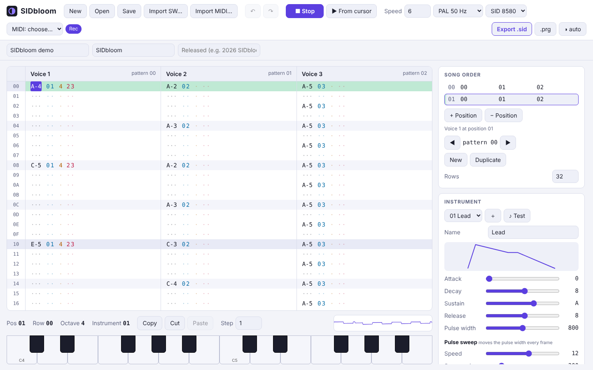
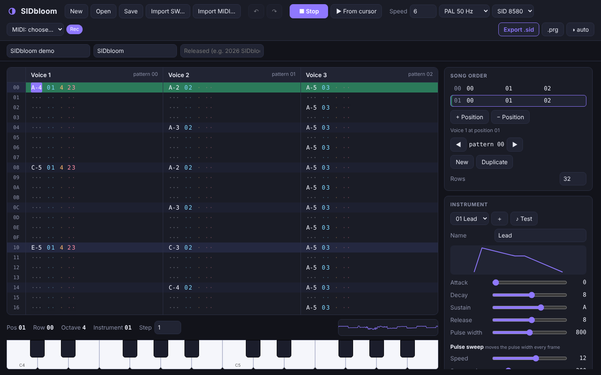
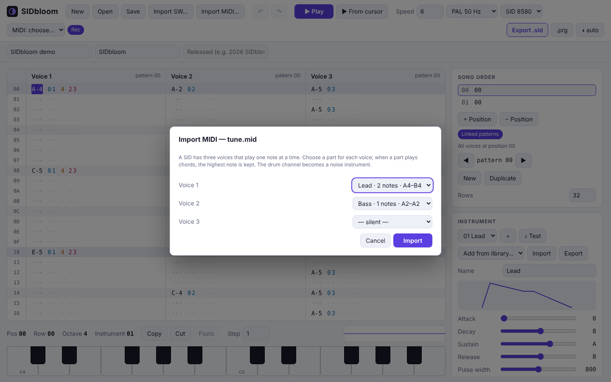
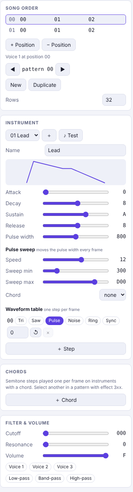

# SIDbloom

A modern, free and open-source 3-channel SID music tracker for Windows and macOS.
Compose C64 music with a clearer interface and export real, C64-compatible `.sid` files.

**Status:** early but working. You can write music, hear it, and export real `.sid` files.



- Tracker UI (React + Tauri): 3 voices, order list, instrument editor (ADSR, waveform table, pulse width + sweep, chords) with a library of drum, bass, lead and pad presets and `.sidi` instrument files, MOD-style linked patterns (one pattern for all voices; optional), copy/paste of selected cells, filter and filter effects (cutoff, resonance, mode, sweep), undo/redo, piano keyboard, oscilloscope, light/dark theme
- Realtime audio: the same Rust engine + reSID, compiled to WebAssembly, running in an AudioWorklet; edits made during playback are heard immediately without restarting
- Export `.sid` (PSID v2, PAL/NTSC, 6581/8580) and a self-starting `.prg` (`LOAD"*",8,1` + `RUN`) with an own 6502 player; verified register-for-register against the engine in a 6502 emulator and played back by the independent `sidplayfp`
- **MIDI file import** (`.mid`): pick which parts play on the three voices; chords are reduced to the top note
- MIDI keyboard input: play and record notes from a MIDI keyboard (desktop app via the system MIDI; browsers with Web MIDI)
- Project files (`.sidb`, JSON). Exported `.sid` / `.prg` files carry the project inside (after the music data) and open again for editing
- **Import of SID-Wizard 1.x modules** (`.swm`, `.prg`, `.p00`): tested against all of SID-Wizard's own demo tunes (50+), which then export and play back identically in the 6502 player. Features this tracker lacks (filter programs, built-in vibrato, absolute-pitch arps, extra subtunes, tempo programs, chord speed) are approximated and listed in an import report

- **Export to SID-Wizard** (`.swm.prg`): continue a tune in SID-Wizard 1.x; what it cannot hold is listed in a report
Planned: more effects. MIDI keyboard input is implemented and tested with a simulated keyboard; it has not been tried with real hardware yet.

See the **[user guide](docs/USER_GUIDE.md)**, the **[changelog](CHANGELOG.md)** and the **[releases](https://github.com/salleq/sidbloom/releases)**. Contributions: see [CONTRIBUTING.md](CONTRIBUTING.md).

## Screenshots
| | |
|---|---|
|  |  |
| *Dark theme (follows the system setting)* | *MIDI import: choose which part plays on each voice* |

<p align="center"></p>

## Download and install
Installers are built for every platform by GitHub Actions (see the **Desktop build** runs under *Actions*, artifacts at the
bottom of each run; tagged versions appear under *Releases* once published).

| System | CPU | Package |
|---|---|---|
| Windows | x64 | `.msi` / `.exe` installer |
| Windows | ARM64 | `.exe` installer (NSIS) |
| macOS | Apple silicon and Intel (universal) | `.dmg` |
| Linux | x64 | `.AppImage`, `.deb`, `.rpm` |
| Linux | ARM64 | `.AppImage`, `.deb`, `.rpm` |

The packages are **not signed** (certificates cost money), so the systems warn on first start:
- **macOS:** right-click the app and choose *Open*, then confirm.
- **Windows:** in the SmartScreen window click *More info*, then *Run anyway*.
- **Linux:** `chmod +x SIDbloom*.AppImage` and run it, or install the `.deb` / `.rpm`. The sound uses ALSA
  (`libasound2`), which every desktop distribution has.

## Layout
- `core/` – Rust: song model, playback engine, 6502 player (`core/player`), export, reSID rendering, CLI
- `wasm/` – WebAssembly bindings of the core
- `app/` – web UI (Vite + React + TypeScript), end-to-end tests in `app/e2e`
- `src-tauri/` – desktop shell (Windows / macOS / Linux)

## Develop
```
cargo test --workspace                 # core tests (needs 64tass for the player check; sidplayfp optional)
cd app && npm ci && npm run wasm       # needs: rustup target add wasm32-unknown-unknown; cargo install wasm-bindgen-cli --version 0.2.100
npm run dev                            # UI in the browser
npm run test:e2e                       # builds are served and driven with Playwright
# desktop app (needs the Tauri prerequisites); run from the repo root:
cd .. && node app/node_modules/@tauri-apps/cli/tauri.js dev
```

## Command line
```
cargo run --release -p sidcore --bin sidbloom -- demo demo.sidb
cargo run --release -p sidcore --bin sidbloom -- render demo.sidb demo.wav 8
cargo run --release -p sidcore --bin sidbloom -- export-sid demo.sidb demo.sid   # plays on a real C64 / any SID player
cargo run --release -p sidcore --bin sidbloom -- import-swm tune.swm.prg tune.sidb
```

License: GPL-3.0-or-later (see `LICENSE`, `NOTICE.md`).
